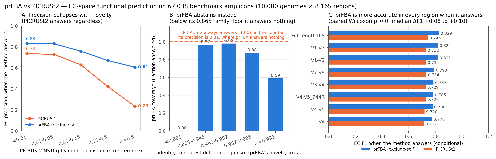

# prFBA vs PICRUSt2 — functional prediction on the 10k region-validation benchmark

Runs the 10,000-genome region-validation amplicon set through **PICRUSt2 2.6.3** and
compares its functional predictions with prFBA's, against the same truth (the source
genome's BV-BRC annotation) in the same namespaces (EC numbers, then ModelSEED
reactions). The two methods answer the same question from opposite directions: prFBA
aligns an amplicon to reference genomes and unions their gene content; PICRUSt2 places
the amplicon in a reference phylogeny and infers gene content by hidden-state
prediction.

**Headline.** When prFBA makes a call, it is the more accurate of the two everywhere
(EC F1 0.80 vs 0.73 overall; conditional per-region median F1 advantage +0.08 to +0.10,
Wilcoxon p ≈ 0 in all eight regions). PICRUSt2 effectively never abstains — 27 of 67,038
amplicons, dropped by `--min_align` — so across the *whole*
amplicon population its mean F1 is higher (0.73 vs 0.60) because prFBA abstains on 25%
of self-excluded amplicons — an abstention rate that is itself mostly a benchmark
artifact of retention depth (see the probe below), not a property of prFBA. PICRUSt2's precision degrades sharply with phylogenetic
distance (0.74 → 0.24 across NSTI bins) while prFBA's degrades slowly (0.83 → 0.61) and
it declines to answer instead. Much of PICRUSt2's apparent deficit is **annotation-system
disagreement, not prediction error**: its own annotation of a genome already in its
reference recovers only 90.4% of that genome's BV-BRC truth ECs at 74.3% precision, so
on the in-reference genomes where that ceiling is measured it is operating at ~96% of its
achievable recall and at its precision ceiling.

## Install (this machine, no conda / no root)

PICRUSt2 needs R and three compiled tools, so it does not fit in a single venv.
Per the session's constraint, the Python side is a uv venv and nothing else is
system-installed:

| component | where | how |
|---|---|---|
| PICRUSt2 2.6.3 + deps | `~/Documents/picrust2_venv` (uv, py3.12, `pandas<3`) | `uv pip install -e ~/opt/picrust2/src/picrust2-2.6.3` (editable: the 470 MB reference files live in the source tree and `setup.py` does not package them) |
| R 4.4.3 + `castor` 1.8.7 | `~/opt/picrust2/R`, `~/opt/picrust2/Rlib` | Posit's Ubuntu 24.04 `.deb` unpacked with `dpkg-deb -x`, hard-coded `/opt/R/4.4.3` paths rewritten, `castor` from Posit Package Manager binaries |
| epa-ng 0.3.8, gappa 0.9.0, HMMER 3.4, GLPK 5.0, zlib/bison/flex | `~/opt/picrust2/bin` | built from source (`src/build_tools.sh`); no project ships usable Linux binaries |

```bash
source ~/opt/picrust2/activate.sh     # venv + PATH + R_LIBS_USER
```

PICRUSt2's own test suite: **60 passed, 1 failed** — the failure is
`test_run_place_seqs_pipeline_sepp`, which needs the optional SEPP placement tool;
EPA-ng is the default and is installed.

## Pipeline

```bash
cd region_validation/picrust2_comparison
python scripts/prepare_inputs.py --outdir data/full_inputs --batches 8
bash   scripts/run_picrust2.sh data/full_inputs data/full_picrust2 2 30   # ~1 h 40 m
python scripts/prfba_selection.py --out data/prfba_selection.json
python scripts/prfba_selection.py --out data/prfba_selection_legacy.json --legacy
python scripts/fetch_bvbrc_annotations.py genomes
python scripts/fetch_bvbrc_annotations.py pgfams        # 4.17M families, ~16 min
python scripts/function_maps.py
python scripts/genome_function_sets.py
python scripts/annotation_ceiling.py
python scripts/compare.py
```

| script | role |
|---|---|
| `prepare_inputs.py` | study FASTA (60,461 md5-unique amplicons) + dummy abundance table, optionally split into batches or a stratified pilot |
| `run_picrust2.sh` | `picrust2_pipeline.py -p 30 --in_traits EC,KO --no_pathways` per batch, resumable |
| `prfba_selection.py` | re-runs the shipped `select_references.select_representatives` per amplicon, include-self and exclude-self (τ=0.987) via `score_genecap.exclude_self_record`; `--legacy` reproduces the manuscript's reducer |
| `fetch_bvbrc_annotations.py` | source-genome assembly accessions; `family_product` for every PGFam in play (explicit User-Agent — BV-BRC 403s Python's default; failed batches are never cached as empty) |
| `function_maps.py` | PGFam product → EC (parsed) and → ModelSEED reactions (ModelSEEDpy `split_role`/`convert_to_search_role` → template roles → complexes → reactions); EC → ModelSEED reactions from `Unique_ModelSEED_Reaction_ECs.txt` |
| `genome_function_sets.py` | projects all 49,109 relevant genomes into EC / reaction space |
| `annotation_ceiling.py` | BV-BRC truth vs PICRUSt2's *own* reference annotation of the same genome |
| `compare.py` | per-amplicon metrics, strata, paired Wilcoxon tests |

Batching is sound because PICRUSt2 treats every study sequence independently: EPA-ng
places per query, the bacteria/archaea choice is per sequence, and an unknown tip cannot
change another tip's parsimony states.

## Comparison design

* **Truth** — the source genome's PGFam set (the same truth `score_genecap.py` uses),
  projected to EC numbers via BV-BRC `family_product` strings.
* **prFBA prediction** — union of the PGFam sets of the reference genomes the shipped
  selector picks, i.e. the content of the synthetic genome, projected identically.
* **PICRUSt2 prediction** — `combined_EC_predicted.tsv.gz`, copy number > 0 (all values
  are integers under max-parsimony HSP).
* **Same projection everywhere.** Family-level products lose some ECs that feature-level
  products carry (0–112 per genome in spot checks), so truth *and* prFBA go through the
  identical map and the loss cancels; `annotation_ceiling.py` prices what remains.
* **Shared vocabulary.** EC metrics are restricted to the 2,132 ECs both annotation
  systems can express (PICRUSt2 columns ∩ BV-BRC family-product ECs); reactions to the
  7,043 reachable from those.
* **Empty truth excluded** — 953 of 67,991 amplicons whose source genome projects to no
  EC are dropped from all means (never scored as failures).
* **Both denominators** — *conditional* (amplicons with a prediction) and *population*
  (abstention = recall 0 / F1 0), as `DESIGN.md` §7 requires.
* **`rxn_role`** — prFBA's PGFam-product → ModelSEED-role → reaction route, reported
  separately (it tracks the EC route within 0.01) and never mixed into the head-to-head.
* **How many references prFBA unions** — median 1 per answered exclude-self amplicon
  (n = 50,341 scored cells), so its precision advantage comes from picking one good
  genome, not from averaging many.



*`figures/F1_prfba_vs_picrust2.png` (+ PDF), from `scripts/render_comparison.py`: (A)
PICRUSt2's EC precision against its own NSTI distance, (B) prFBA's coverage against its
novelty axis, (C) per-region conditional F1.*

## Results (EC space, all regions, n = 67,038)

| method | coverage | recall | precision | F1 | Jaccard | population recall | population F1 |
|---|---|---|---|---|---|---|---|
| prFBA include-self | 1.000 | 0.999 | 0.943 | 0.964 | 0.942 | 0.999 | 0.964 |
| prFBA exclude-self (τ=0.987) | 0.751 | 0.835 | 0.790 | **0.798** | 0.690 | 0.627 | 0.600 |
| PICRUSt2 | 1.000 | 0.849 | 0.669 | **0.729** | 0.595 | 0.848 | 0.729 |

ModelSEED reaction space tracks EC space within ~0.01 throughout (prFBA exclude F1
0.801, PICRUSt2 0.722). The legacy selector scores marginally higher than the shipped
union default when it answers (exclude F1 0.807 vs 0.798) at the same coverage.

prFBA's include-self row is near-tautological — include-self selection usually picks the
source genome itself, whose annotation *is* the truth — exactly as the region study's
95–99% include-self gene capture is. The informative rows are exclude-self and the
strata below.

### Stratified by whether the source genome is in PICRUSt2's reference

2,720 of 9,746 benchmark source genomes (19,686 amplicons) have their exact assembly in
PICRUSt2's reference (GTDB-based lineages; the shipped metadata does not state a
release); a further 1,493 share an NCBI taxid with a reference
genome. This is PICRUSt2's closest analogue to prFBA's self-inclusion, though an
imperfect one: GTDB is species-dereplicated, so "not in reference" often still has a
conspecific, and prFBA's exclusion additionally strips every ≥0.987-identity neighbour.

| stratum | method | coverage | recall | precision | F1 |
|---|---|---|---|---|---|
| in reference (n=19,686) | PICRUSt2 | 1.000 | 0.868 | 0.735 | 0.792 |
| | prFBA include | 1.000 | 1.000 | 0.967 | 0.981 |
| | prFBA exclude | 0.827 | 0.863 | 0.836 | 0.840 |
| not in reference (n=47,352) | PICRUSt2 | 1.000 | 0.841 | 0.641 | 0.703 |
| | prFBA include | 1.000 | 0.998 | 0.933 | 0.957 |
| | prFBA exclude | 0.719 | 0.821 | 0.768 | 0.779 |

### Precision under increasing novelty

PICRUSt2 answers every amplicon at any distance; the cost is precision.

| PICRUSt2 NSTI | n | PICRUSt2 recall | PICRUSt2 precision | prFBA-exclude recall | prFBA-exclude precision |
|---|---|---|---|---|---|
| < 0.01 | 19,770 | 0.871 | 0.735 | 0.860 | 0.830 |
| 0.01–0.05 | 23,076 | 0.857 | 0.729 | 0.869 | 0.829 |
| 0.05–0.15 | 16,588 | 0.829 | 0.628 | 0.820 | 0.759 |
| 0.15–0.5 | 6,877 | 0.812 | 0.420 | 0.730 | 0.669 |
| ≥ 0.5 | 701 | 0.768 | 0.235 | 0.661 | 0.607 |

By prFBA's own novelty axis (best non-self identity), the contrast is sharper still: for
the 567 amplicons whose nearest different organism is below the 0.865 family floor,
prFBA abstains on all of them (coverage 0.000) while PICRUSt2 still predicts, at
precision 0.313.

### Per-amplicon paired comparison (EC F1, Wilcoxon, Holm-adjusted)

| region | conditional: prFBA / PICRUSt2 | median Δ | prFBA wins / losses | population: prFBA / PICRUSt2 | median Δ |
|---|---|---|---|---|---|
| FullLength16S | 0.829 / 0.740 | +0.091 | 5,236 / 712 | 0.683 / 0.745 | +0.075 |
| V1-V2 | 0.821 / 0.729 | +0.096 | 5,135 / 875 | 0.662 / 0.731 | +0.075 |
| V1-V3 | 0.822 / 0.729 | +0.096 | 5,325 / 848 | 0.676 / 0.732 | +0.078 |
| V3-V4 | 0.787 / 0.710 | +0.080 | 4,891 / 1,169 | 0.578 / 0.728 | +0.041 |
| V4 | 0.776 / 0.695 | +0.082 | 5,280 / 1,382 | 0.547 / 0.716 | +0.032 |
| V4-V5 | 0.780 / 0.699 | +0.085 | 5,413 / 1,259 | 0.553 / 0.720 | +0.037 |
| V4-V5_944R | 0.785 / 0.707 | +0.082 | 5,206 / 1,207 | 0.559 / 0.729 | +0.037 |
| V7-V9 | 0.793 / 0.716 | +0.085 | 5,189 / 1,209 | 0.580 / 0.734 | +0.043 |

Every test is significant (p_holm ≤ 5e-14; conditional tests p ≈ 0). Note the sign
reversal between denominators: the *median* amplicon favours prFBA under both, but
prFBA's abstentions pull its *mean* below PICRUSt2's in the population view.

### Annotation-system ceiling (the number that frames everything above)

For the 2,689 scoreable genomes present in both systems, PICRUSt2's own reference
annotation vs BV-BRC truth for the *same genome* — no prediction involved:

| universe | recall | precision | Jaccard |
|---|---|---|---|
| shared vocabulary | 0.904 | 0.743 | 0.688 |
| full vocabulary | 0.891 | 0.676 | 0.623 |

So PICRUSt2's measured 0.868 recall / 0.735 precision on in-reference genomes is ~96% of
its ceiling recall and essentially *at* its ceiling precision: as a predictor it is
nearly perfect, and the residual gap to prFBA in this benchmark is dominated by the two
projects annotating genomes differently. An equivalent study scored against PICRUSt2's
annotation system rather than BV-BRC's would move the absolute numbers, not the
coverage-vs-precision trade-off, which is the real finding.

### Other observations

* **Domain routing.** PICRUSt2 sends 10.2% of archaeal amplicons (467 of 4,587) to the
  bacterial tree, since it picks whichever domain gives the lower NSTI; 99.9% of
  bacterial amplicons route correctly (`data/domain_routing.csv`).
* **Direct agreement.** prFBA include-self and PICRUSt2 agree on only Jaccard 0.57–0.61
  of ECs per amplicon (mean, by region) — consistent with the annotation ceiling rather
  than with either method being wrong.
* **PICRUSt2 exclusions.** 24 sequences (27 amplicons) aligned to under 80% of the
  reference (`--min_align`) and were dropped before placement; ~80 more exceed the
  default NSTI 2.0 cutoff that standard PICRUSt2 usage discards.
* **Vocabulary asymmetry.** 95.3% of the 4.17M PGFams in play are "hypothetical
  protein"; only 16,633 carry an EC. Genomes project to a median of 472 ECs.

## Retention-depth probe (why prFBA's coverage column is a lower bound)

prFBA's 75.1% coverage above is not a limit of the method. Self-exclusion deletes
the source genome, its taxon and every hit at identity >= 0.987 from a record the
aligner already truncated to its top 20, so for an organism in a dense cluster the
filter empties the record and the selector abstains for want of input. Of the
15,888 self-exclusion abstentions, **15,026 (94.6%) are emptied records** and only
862 (5.4%) have survivors failing the 0.865 family floor. Include-self coverage is
1.000 in every identity bin, and production is unaffected -- nothing deletes hits
there, and a genuinely novel organism has no >= 0.987 relatives to remove.

`scripts/depth_probe_sample.py` samples 320 emptied-record amplicons (40/region,
seed 1729); they are re-aligned with `--k2 500 --gpu-cand 500` (command otherwise
identical to the validation run, ~4 min for 316 unique sequences) and
`scripts/depth_probe_eval.py` re-runs the same exclusion and selection path.
The re-run reproduces the original top-20 scores exactly.

| persistence depth | cumulative recovery |
|---|---|
| <= 20 (shipped) | 0% |
| 50 | 46.2% |
| 100 | 68.4% |
| 200 | 78.1% |
| 500 | **88.4%** (283/320; 37 saturated lineages remain) |

Recovered references are genus-tier (281/283) at median surviving identity 0.9856,
and are of ordinary quality rather than dregs: EC recall 0.854 / precision 0.747 /
F1 **0.783**, against 0.835 / 0.790 / 0.798 for amplicons that already answered and
0.729 for PICRUSt2; anchors are 80.3% family-correct and 60.1% genus-correct.

Projected onto all 15,026 emptied records (from a 40-per-region sample, not a
re-run): self-exclusion coverage 0.766 -> ~0.96, population genus accuracy
0.375 -> ~0.49, and prFBA's population EC F1 0.600 -> ~0.75 -- which would cross
PICRUSt2's 0.729 and reverse the one metric PICRUSt2 currently wins. The prefilter
already scores 500 candidates and dominates runtime (14,640 s of the 16,120 s
panel alignment), so depth 100 costs essentially nothing beyond the current run.

One production-side caveat, distinct from abstention: for 2,130 of 60,461 amplicon
sequences (3.5%) all 20 retained hits are tied at the best alignment score,
spanning a median of 7 species, so those probability weights come from a truncated
sample of the co-optimal set. 64% of amplicons have a unique best hit.

## Caveats

1. PICRUSt2 cannot be made self-excluding per amplicon (its reference is fixed), so the
   in-reference / not-in-reference split is an approximation of prFBA's two regimes.
2. Database sizes differ by ~4×: prFBA selects from ~112k BV-BRC genomes with cached
   PGFams, PICRUSt2 from 27,870 reference genomes. Part of prFBA's precision advantage
   is database coverage, not algorithm.
3. Truth is BV-BRC/RAST annotation projected through family products; see the ceiling
   section. Both sides share the projection, but PICRUSt2's annotations were made by a
   different pipeline on GTDB assemblies.
4. Predictions are binarized (copy > 0 / present in any selected reference). prFBA's
   per-function probabilities and PICRUSt2's copy numbers are not compared here.
5. KO predictions were produced but not analysed: ModelSEED carries no local KO →
   reaction map, so EC is the only bridge both systems share.

## Files

Everything under `data/` is git-ignored except the distilled summaries
(`comparison_summary.json`, `annotation_ceiling.json`, `domain_routing.csv`). Bulk
artifacts: `full_picrust2/` (per-batch PICRUSt2 output), `comparison_cells.csv.gz`
(per-amplicon × method × space rows), `pgfam_products.json` (~400 MB),
`genome_function_sets.json`, `prfba_selection*.json`.

## PICRUSt2 and MAGs: can it take one, and match it? (2026-10-16)

The MAG arm (`mag_validation/`) matches a whole genome to reference genomes by ANI with
skani. Can PICRUSt2 be run on the same MAGs as a comparator? **Not natively. A MAG reaches
PICRUSt2 only through a 16S gene it carries, and then PICRUSt2 performs as it does on that
organism's full-length 16S amplicon, with the same accuracy. What changes is coverage, i.e.
whether the MAG has a usable 16S at all, and that is low for real MAGs.**

### No genome input

PICRUSt2's study input is a FASTA of marker sequences plus an abundance table. `place_seqs.py`
hmmaligns each query to the 16S profile (`--trim`) and drops any whose aligned length is under
`--min_align` × its own length. The default is 0.8; `--help` prints "0" because the help string
formats the float with `%(default)d`. Its only notion of a match is EPA-ng placement of a 16S
into the 16S reference tree. It has no genome-to-genome comparison.

`scripts/mag_direct_feed.py` hands it one synthetic MAG as-is (3048874.6 at 100%: 37 contigs,
1.09 Mb, one 16S on contig `s22`):

* **Defaults:** exit 1, `Stopping - all 37 input sequences aligned poorly to reference
  sequences`, after 2.5 min (20.9 GB peak for the run; `place_seqs.py` alone stops the same way
  in 29 s at 4.5 GB).
* **`--min_align 0`:** runs (5.7 min, 40.7 GB) and treats every contig as a separate organism.
  hmmalign aligns the 1,551-nt 16S of `s22`, trimming the contig flanks, and 1–23 residues of
  each other contig. Those 36 are placed anyway, with NSTI 0.00015 to 0.243 (35 under 0.15, so NSTI does not flag them).
  30 go to the archaeal tree, and they land on 18 different closest references. The union over
  contigs is 1,429 predicted ECs against 93 true (F1 0.12). Contig `s22` alone reproduces
  PICRUSt2's FullLength16S-amplicon prediction for this genome exactly (164 ECs, F1 0.654).

### The route that works: extract the 16S

`scripts/mag_extract_16s.py` regenerates synthetic MAGs with `synth_mags.py` (deterministic,
bit-identical to what skani searched). It finds 16S genes in each MAG's own contigs with
`nhmmer` and PICRUSt2's bacterial and archaeal profiles, then runs the stock pipeline
(`run_picrust2.sh`) on the extracts. The sample is 400 genomes × {100, 50, 30, 10% clean;
100, 50% with 10% contamination}, 2,400 MAGs. When a MAG has several 16S copies, the rule is to
take the longest.

| sample (uncontaminated MAGs, n = 1,600) | value |
|---|---|
| MAGs with a 16S locus of at least 250 bp | 816 |
| extracted 16S loci PICRUSt2 rejected (`--min_align`) | 0 |
| chosen extract byte-identical to a locus of the source genome | 98.3% |
| same EC set as the benchmark's FullLength16S amplicon (full-length extracts, n = 586) | 82.3% (mean Jaccard 0.979) |
| same, partial extracts (n = 16) | 31% (Jaccard 0.718) |
| EC F1, extracted 16S vs FullLength16S amplicon (n = 589) | **0.746 vs 0.747** |
| multi-copy MAGs whose copies give different predictions | 80 of 316 (25%) |

**PICRUSt2 on a MAG is PICRUSt2 on that organism's full-length 16S.** It differs only by the
sequence boundaries (nhmmer envelope vs. 27F/1492R product; median NSTI shift 0.012). Its
accuracy, conditional on the MAG carrying a 16S, is therefore the FullLength16S number that
both existing comparisons already report:

* as-shipped: 0.740 (table above);
* controlled (shared reference, leave-genus-out, `shared_reference/`, n = 7,181): **0.785**.
  On the same cells, prFBA scores 0.692 at coverage 0.890 (0.755 forced to answer), the
  constant floor 0.655, nearest neighbour 0.752, and the clade-max oracle 0.789.

The MAG adds two new failure modes. One is copy choice: a quarter of multi-copy MAGs get
different predictions depending on which copy is used. The other is contamination: in the
10%-contaminated sample MAGs, the longest-copy rule picks the **donor's** 16S for 92 of 624
16S-bearing MAGs (54 of them with the source's 16S present). Those MAGs score EC F1 0.534,
against 0.709 where the source's copy was chosen.

### Coverage: what a MAG changes

`scripts/mag_16s_loci.py` locates every 16S gene in the 9,997 source genomes (nhmmer, same
profiles). `scripts/mag_16s_retention.py` then replays `synth_mags.py` on coordinates
(its own `fragment()` / `take_to_fraction()` on span objects, same seeds) to decide, for every
synthetic MAG the MAG arm searched, whether a 16S survived. The replay reproduces all 189,943
`src_bp` values and all 139,958 uncontaminated `n_contigs` in the MAG-arm manifests. It agrees
with the real extraction on all 2,400 sample MAGs for whether a usable 16S is present.

| synthetic MAG completeness | PICRUSt2 has a usable 16S (>= 250 bp) | full-length 16S kept whole | prFBA selects a reference: include / exclude |
|---|---|---|---|
| 100% | **0.884** | 0.821 | 1.000 / 0.314 |
| 90% | 0.840 | 0.778 | 1.000 / 0.315 |
| 70% | 0.728 | 0.672 | 1.000 / 0.312 |
| 50% | **0.594** | 0.544 | 1.000 / 0.313 |
| 30% | 0.427 | 0.391 | 1.000 / 0.314 |
| 20% | 0.330 | 0.299 | 1.000 / 0.312 |
| 15% | 0.259 | 0.231 | 1.000 / 0.307 |
| 10% | 0.204 | 0.181 | 1.000 / 0.301 |
| 5% | 0.120 | 0.104 | 1.000 / 0.297 |
| 1% | **0.044** | 0.037 | 0.998 / 0.259 |

All 9,997 genomes per tier. The prFBA column is any reference selected
(`mag_prfba_ec.py`).

Even at 100%, 11.6% of MAGs have no usable 16S:

* 1,023 genomes carry their 16S only on deposited contigs shorter than 2.5 kb. Those are
  collapsed rRNA contigs in draft assemblies, which `synth_mags.py` drops at `MIN_FRAG` just as
  MetaBAT2 does.
* 120 genomes have no 16S at all.
* 16 genomes have only sub-250 bp fragments.

Below 100%, a 16S survives only if its fragment does. PICRUSt2's usable-16S rate drops below
the prFBA exclude arm's flat ~0.31 between 20% and 15% completeness.

**Real MAGs are far worse than synthetic ones** (`scripts/mag_gtdb_ssu.py`, GTDB r232's own SSU
calls; "isolate" means no metagenome or single-cell category; completeness is CheckM2's
estimate, not the base-pair fraction the synthetic MAGs are cut to):

| CheckM2 completeness | MAGs: any 16S | MAGs: >= 1200 bp | isolates: any 16S |
|---|---|---|---|
| 95–100% | 0.321 (n = 177,544) | 0.206 | 0.975 |
| 90–95% | 0.276 | 0.155 | 0.913 |
| 80–90% | 0.185 | 0.098 | 0.889 |
| 70–80% | 0.165 | 0.099 | 0.867 |
| 50–70% | 0.175 | 0.127 | 0.866 |
| all | **0.255** (n = 450,594) | **0.154** | 0.974 |

The synthetic panel overstates PICRUSt2's MAG coverage 3–4×: near-complete real MAGs carry
any 16S 32% of the time and a full-length one 21%, against 88% and 82% for 100% synthetic
MAGs. Whole-contig dropping cannot reproduce rRNA operons that fail to assemble or bin. On real
MAGs PICRUSt2 could answer for about one in four (one in seven with a full-length 16S).
prFBA's MAG arm needs no marker gene, so its coverage is set by the reference database instead:
0.31 self-excluded on the 9,997-genome panel, 0.56 against GTDB r226 (RESULTS_v2), and about
1.0 when the organism itself is in the database.

### Contamination: whose 16S is it?

The contaminated tiers here use the current synthesizer (with the `allow_empty` graft fix).
These are new data; RESULTS_v2 withdrew every contamination result from the old one.

| 10% contamination | source 16S only | donor 16S only | both | neither |
|---|---|---|---|---|
| 100% | 0.696 | 0.025 | 0.188 | 0.091 |
| 70% | 0.612 | 0.042 | 0.117 | 0.229 |
| 50% | 0.524 | 0.043 | 0.071 | 0.362 |
| 30% | 0.397 | 0.042 | 0.033 | 0.529 |

A donor-only MAG makes PICRUSt2 confidently predict a different phylum. A both-16S MAG makes
the copy rule decide; in the sample, the donor was chosen in 15% of 16S-bearing contaminated
MAGs. Real MAGs show the same problem. In GTDB r232, a MAG's 16S disagrees with its genome
phylum 6.6% of the time (6,810 of 103,747), against 0.53% for isolates. The phylum labels are
isolate-calibrated: a SILVA phylum counts as consistent if it names at least 5% of that GTDB
phylum's isolates, which absorbs Firmicutes/Bacillota-style renaming. How prFBA's MAG arm
handles contamination is unmeasured. Its selector uses whole-genome ANI with an AF gate, and the
one-organism pilot (`mag_validation_pilot/FINDINGS.md`) saw that gate pick the source over a
spliced donor, but RESULTS_v2 withdrew the contamination grid.

### PICRUSt2's own reference already contains MAGs, but only 16S-bearing ones

PICRUSt2 2.6.3's 27,870 reference genomes (26,868 bacterial, 1,002 archaeal; GCA/GCF accessions
with GTDB lineages; CheckM completeness >= 90%, contamination <= 10%) include **4,946 MAGs
(17.7%)** and 39 SAGs, by GTDB r232's genome category. Every one carries a 16S, because
placement needs it. Among the MAG references, 3.65% have a 16S whose SILVA phylum disagrees
with the genome, against 0.27% for isolate references. That is consistent with those 16S
having been binned from another organism.

Custom references are possible: `shared_reference/scripts/build_reference.py` builds one per
fold. They still need a 16S of 1,200–1,800 bp for every reference genome, so a MAG without one
cannot become a reference either.

### EC-space head-to-head on the synthetic panel (as-shipped style)

`scripts/mag_prfba_ec.py` re-derives the MAG arm's selected reference sets; all 279,916 match
the scorer's recorded anchor and set size. `scripts/mag_score.py` then scores both methods on
every uncontaminated synthetic MAG (9,997 genomes × 14 tiers) in `compare.py`'s EC space.
Cells whose truth or a prFBA pick has no EC projection are dropped for every method (2,240
empty truth, 3,332 unprojected truth, 551 unprojected picks).

PICRUSt2's prediction is the one for the exact 16S locus the MAG keeps. The panel run covers
every distinct locus, and 20,301 of 20,302 were predicted. In 947 cells the only 16S was cut by
a fragment boundary; those get the prediction for the whole locus, which slightly flatters
PICRUSt2. `picrust2_mag_full` (whole full-length loci only) is in the summary JSON.

| completeness | PICRUSt2 via 16S: coverage | conditional F1 | population F1 | prFBA exclude: coverage | conditional F1 | population F1 |
|---|---|---|---|---|---|---|
| 100% | 0.891 | 0.710 | 0.633 | 0.308 | 0.937 | 0.288 |
| 70% | 0.736 | 0.721 | 0.531 | 0.306 | 0.937 | 0.287 |
| 50% | 0.601 | 0.728 | 0.438 | 0.307 | 0.937 | 0.288 |
| 30% | 0.432 | 0.735 | 0.317 | 0.307 | 0.936 | 0.287 |
| 25% | 0.386 | 0.737 | 0.285 | 0.310 | 0.937 | 0.290 |
| 20% | 0.334 | 0.742 | 0.247 | 0.306 | 0.936 | 0.287 |
| 10% | 0.208 | 0.744 | 0.154 | 0.296 | 0.935 | 0.276 |
| 1% | 0.045 | 0.749 | 0.034 | 0.255 | 0.929 | 0.237 |

Coverage here (0.891 at 100%) differs from the coverage table above (0.884). This table covers
the ~9,556 genomes per tier that can be scored; the one above covers all 9,997.

Calibration, on the same cells:

* **Constant floor:** always predicting the 430 most prevalent ECs scores **0.633**.
* **PICRUSt2 on the genome's own longest 16S, as if always recovered:** 0.719 at coverage 0.996.
  On genomes that have a FullLength16S amplicon it scores 0.745, the benchmark's number. Archaea
  (0.682) and genomes whose only 16S is partial (0.429, n = 323) pull the average down.
* **prFBA include:** 1.000, because it selects the source genome itself.
* **PICRUSt2 by reference membership:** conditional F1 0.791 when the source genome is in its
  reference, 0.681 when it is not.
* **Paired:** on the 2,539 MAGs at 100% that both methods answer, prFBA exclude scores 0.935 and
  PICRUSt2 0.790; prFBA wins 2,513 to 26. In the not-in-reference stratum it is 0.933 vs 0.781
  (n = 1,878).
* **Population F1** (abstention scored 0) crosses near 25% completeness. The constant floor
  matches or beats both methods on it at every tier, so here population F1 mostly measures
  coverage.

**Read this as as-shipped, not as a comparison of inference strategies.** It inherits the
asymmetries the controlled design removed for amplicons:

* Truth is BV-BRC annotation, which is prFBA's own vocabulary. PICRUSt2's own annotation of the
  *same* genome reaches only recall 0.904 and precision 0.743 against it (F1 ≈ 0.82, the
  annotation ceiling above).
* prFBA searches the BV-BRC panel; PICRUSt2 searches its own 27,870 genomes.
* prFBA exclude removes every hit at ANI >= 95. With the stock reference PICRUSt2 cannot
  self-exclude; in-reference vs not is the only analogue.

On amplicons, removing those asymmetries reversed the ranking (PICRUSt2 0.779 vs prFBA 0.687).
The MAG arm has not been run in that harness.

The MAG-specific results that hold regardless are coverage and contamination. **Next step:**
run the prFBA MAG arm inside `shared_reference/`, with skani against each fold's ~7,175
reference genomes and leave-genus-out exclusion. PICRUSt2's side needs few new runs. For most
bacterial genomes, the harness's FullLength16S cells gated by 16S retention are its MAG arm.
Archaea and genomes with no 27F/1492R product would need their extracted 16S loci run against
the fold references.

### Side findings

* **179 of `src16s_10k.fasta`'s 10,000 "16S" records are not 16S genes.** They get no hit from
  either 16S profile; 1191523.27's, for example, is a 1,920 bp protein-coding gene.
  `scripts/src16s_hmm_check.py` lists them. In-silico PCR amplifies nothing from them, so they
  left the benchmark silently: they are 179 of the 254 panel genomes with no
  `benchmark_truth.json` entry, and no scored cell comes from one. A further 456 records carry
  a 16S plus a large non-16S remainder.
* 37 MAG-arm source genomes have a real annotated 16S that is absent from their downloaded
  contigs (`mag_validation/contigs`). Three assemblies are under 50 kb (1821960.43: 9.7 kb),
  possibly truncated downloads.
* `picrust2_pipeline.py --help` says `--min_align` defaults to 0. It is 0.8.

### Reproduce

```bash
cd region_validation/picrust2_comparison
export PATH=~/opt/picrust2/bin:$PATH; PY=~/Documents/py_venv/bin/python
$PY scripts/mag_direct_feed.py                  # raw MAG -> PICRUSt2, three runs (~10 min)
$PY scripts/mag_16s_loci.py --fasta-dir ../../mag_validation/contigs \
    --fasta-dir ../../mag_validation/donor_contigs \
    --hmm data/mag_arm/hmm/ssu_bac_arc.hmm --out data/mag_arm/loci.jsonl    # ~15 min
$PY scripts/mag_16s_retention.py                # replay of every synthetic MAG (~30 s)
$PY scripts/mag_gtdb_ssu.py                     # needs data/mag_arm/gtdb/*_metadata_r232.tsv.gz
$PY scripts/mag_extract_16s.py --n 400          # sample: regenerate, extract
bash scripts/run_picrust2.sh data/mag_arm/sample/inputs data/mag_arm/sample/picrust2 1 60
$PY scripts/mag_extract_16s.py --panel --batches 4
TRAITS=EC bash scripts/run_picrust2.sh data/mag_arm/panel/inputs data/mag_arm/panel/picrust2 2 30
$PY scripts/mag_prfba_ec.py                     # re-derive the MAG arm's selections
$PY scripts/mag_score.py
$PY scripts/src16s_hmm_check.py
```

`data/mag_arm/hmm/ssu_bac_arc.hmm` is PICRUSt2's `bac_ref.hmm` and `arc_ref.hmm` concatenated.
`data/mag_arm/gtdb/{bac120,ar53}_metadata_r232.tsv.gz` are GTDB release 232's metadata files
(`data.gtdb.ecogenomic.org/releases/release232/`).
Distilled results (tracked): `data/mag_direct_feed_summary.json`,
`data/mag_retention_summary.json`, `data/mag_gtdb_ssu_summary.json`,
`data/mag_score_summary.json`, `data/src16s_hmm_check_summary.json`. Bulk outputs live in
`data/mag_arm/` (ignored).
